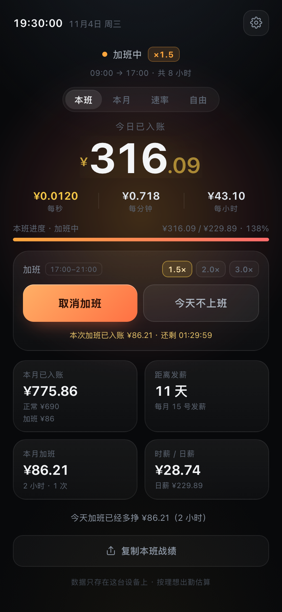
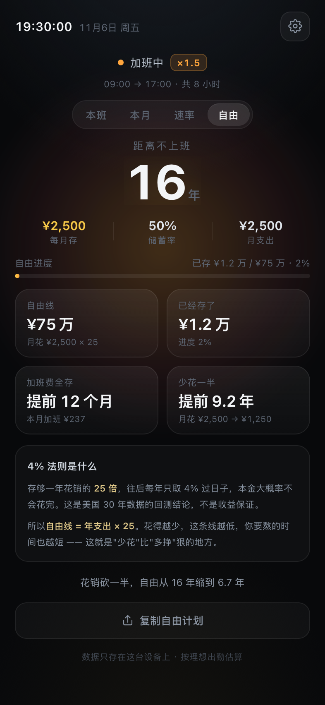

# Money Meter — watch every second you earn

A single-file web app that turns a monthly salary into a live per-second counter, built for people who work **shifts** and **overtime**.

Keywords: salary ticker · overtime calculator · night shift · 4% rule (FIRE) · PWA · single-file HTML · no build step.

  
  &nbsp;&nbsp;
  

## Why it exists

Most "salary tickers" assume your rate never changes. In reality overtime pays 1.5×, weekends pay 2×, and a night shift crosses midnight — so the money per second is **piecewise**, not constant. This app models it that way.

- **Shift-based accounting** — 16:20 → next day 00:20 is one shift, not two days
- **Scheduled overtime** — set the window once (e.g. 17:00–21:00), then one tap enables it for the day
- **Breaks are unpaid** — one or more break windows are deducted inside and outside the shift (4h → 3.5h by default)
- **Day off / weekend work / statutory holiday** — one tap for a leave day, a double-pay rest day, or a 3× holiday shift
- **Cycle schedules** — "N days on, M days off" (4-on-1-off, alternating days) with a date anchor and a next-8-days preview
- **Fix past days** — a record panel lists the last 30 days; backfill a missed overtime or delete a wrong entry
- **Backup** — export / import the whole config and day flags as JSON, so a cache wipe is not data loss
- **Categorized settings** — shift / overtime / freedom / data / update, each on its own tab
- **Built-in changelog** — version, date and notes for every release; a gold dot on the gear when something new ships
- **One-screen dashboard** — the main view scales with viewport height, so it fits a phone screen without scrolling
- **Offline-first PWA** — a service worker caches the app; after the first visit it opens instantly, even without a network
- **Month view** — money, days worked, overtime days, average per shift
- **Freedom view** — 4% rule target, years until you can stop, and the two levers: save the overtime, spend less

Everything is stored in `localStorage`. No account, no server, no tracking.

## Run it

Open `index.html` — that's it. No install, no build, no dependencies.

On a phone: use the same Wi-Fi and run `./start.command` (macOS). It prints a QR code and copies the LAN URL to your clipboard. Add to home screen for a full-screen app.

## Screenshots

| | |
| --- | --- |
|  |  |
| Overtime in progress | 4% rule / years until freedom |

## How the math works

- Rate per second = salary ÷ (accounting days × paid seconds per shift)
- Overtime only counts time **outside** the regular shift, minus breaks
- Freedom line = monthly expenses × 12 × 25 (the 4% rule); compounding at your assumed real return

Tests: `node tests/core.test.mjs` (224 assertions covering overnight shifts, multi-break deduction, holidays, cycle schedules, import validation/migration, the 4% rule and edge cases).

## License

MIT
