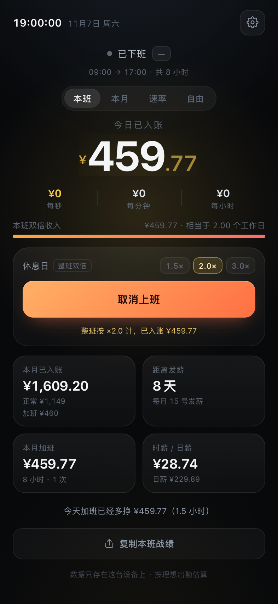
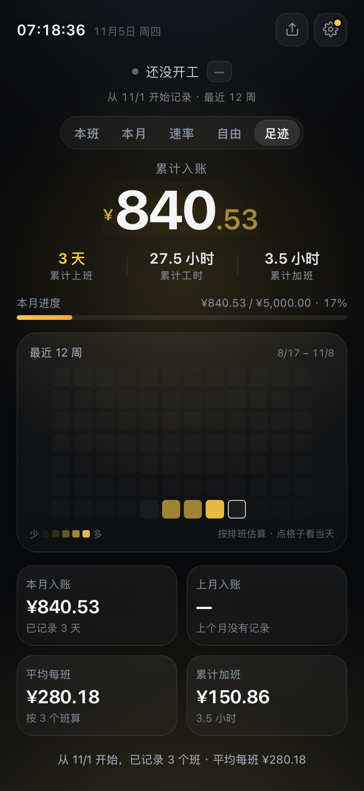
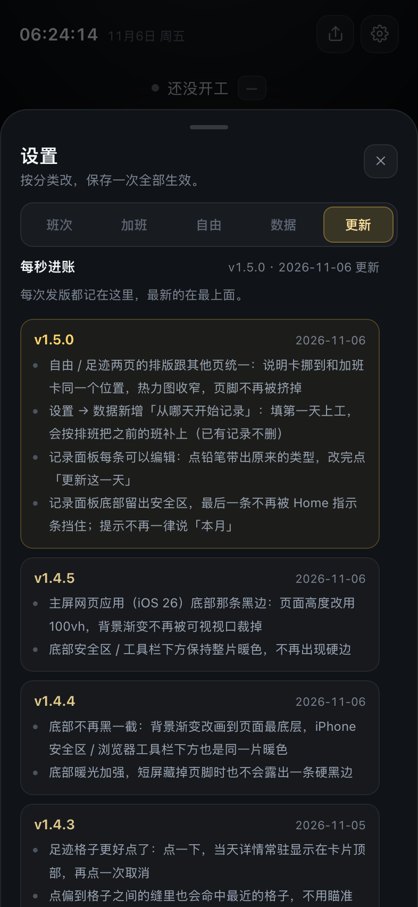

# 每秒进账 · 班次版

把月薪拆成"每秒进账多少"，上班时间自己往上涨。**按班次算，不按自然日算**——下午 16:20 上的那一班，到次日 00:20 都算同一班；加班时段提前设好，要加班点一下按钮就行。

<p align="center">
  
  &nbsp;&nbsp;
  
</p>

---

## 现在就能用

**手机上看（推荐）**

1. 手机和电脑连**同一个 Wi-Fi**
2. 双击 `start.command`，终端里会直接画出一个**二维码**（同时把地址复制到剪贴板）
3. 用手机**相机**对着二维码扫一下 → 自动打开
4. 打开后点「分享 → 添加到主屏幕」，之后桌面就有个图标，点开是全屏 App
5. 第一次打开会建立离线缓存，**第二次起基本秒开，没网也能进**

终端里长这样：

```
  💰 每秒进账 已启动

  手机相机扫这个二维码，直接打开：
  ████████████████████████████
  ██  ▄▄▄▄▄ █▀█ █▄█ ▄▄▄▄▄  ██
  ...
  手机地址：http://192.168.1.2:8765
```

不想扫码也行，地址就在二维码下面，手打也就十几个字符。

> 注意：手机打开的是**你电脑上这个服务**，所以电脑要开着、终端窗口别关。
> 关掉终端或者电脑睡眠，手机上就打不开了。

**只在自己电脑上看**

直接双击 `index.html` 就行，不用起服务。

第一次打开会自动弹设置，已经按这套预填好了：

> 月薪 5000 · 上班 09:00–17:00 · 加班 17:00–21:00 · 中间休息 17:30–18:00

对一下数字、点保存就能用。设置顶部有一块**实时折算**，改哪一项都会立刻重算（见下面的截图）。

主界面会按**真实可用高度**（扣掉刘海、底部安全区）自动收紧，手机上一屏就能看完（本班 / 本月 / 速率 / 自由四个视图都是），不用上下滑；放不下时先藏次要信息（页脚、四格补充行、一句总结），不会把字越缩越小。设置面板内容多，仍然需要滚动。

<p align="center">
  
</p>

改下班时间时**加班开始时间会自动跟着走**：原本 17:00–21:00，你改成 18:00 下班，加班就变成 18:00–22:00，中间的休息时段也一起挪 —— 不用改两遍。如果你想加班不从下班开始，手动改一下加班开始时间，之后它就不再跟着跳。

---

### 手机打不开？

按顺序排查：

1. **同一个 Wi-Fi**：手机连的是不是和电脑同一个网络（不是 4G/5G，也不是访客网络）
2. **访客网络隔离**：很多路由器的 Guest Wi-Fi 会禁止设备互访，换回主网络
3. **防火墙**：系统设置 → 网络 → 防火墙，如果开着「阻止所有传入连接」，给 Python 放行
4. **Mac 睡眠**：电脑睡了服务就断了，临时改一下「显示器关闭时防止自动进入睡眠」

---

## 你这套班次是怎么算的

| 项目 | 数值（月薪 5000、21.75 天、9:00–17:00） |
| --- | --- |
| 每班计薪 | 8 小时 = 28800 秒 |
| 每秒进账 | ¥0.0080 |
| 时薪 / 日薪 | ¥28.74 / ¥229.89 |
| 加班时段 | 17:00–21:00（4 小时） |
| 扣掉休息 | 17:30–18:00（30 分钟） |
| **加班实际计费** | **3 小时 30 分** |
| 加班一次 | ¥150.86（¥43.10 / 小时） |
| 周末整天 | ¥57.47 / 小时 |

几条刻意的规则：

- **休息从上班和加班里都会扣。** 17:30–18:00 落在这个班次外，所以不影响 8 小时正常工资；但它落在加班时段里，所以加班只算 3.5 小时，不是 4 小时。
- **按班次归属。** 凌晨 00:10 你还在班上，界面显示的就是前一天那一班，标题会写"11/4 班次"；下班（含加班）之后才切到新的一天。
- **加班时段提前设好。** 不用掐表、不用记得点结束，点一下「今天加班」，到点自动按倍率开始计，结束自动停。
- **加班和上班重叠的部分不算。** 如果你的加班时段落在班次里面，那段不重复计钱（界面会提示）。
- **休息日点「今天上班」整班双倍。** 周六去上班，点一下，整班按 2× 算。
- **请假点「今天不上班」。** 本班直接归零，月度累计也跟着扣掉。
- **法定节假日点「按节假日算」。** 工作日整班按 3× 计（倍率在设置里可改），不用再手选 3×；再点一下取消。周末赶上节假日，就用「休息日上班」+ 3× 表达。
- **休息可以设多段。** 设置里「休息时段」能加/删，跨零点的长夜班可以同时扣晚饭和夜宵；开始和结束时间不能一样。

---

## 不是每周一至五？用「上几休几」

设置里「上班怎么排」有两个选项：

- **按星期**：每周固定，比如周一到周五、周一到周六
- **上几休几**：轮班。上四休一就填「上 4 天 · 休 1 天」，做一休一就填「上 1 天 · 休 1 天」

循环排班要定一个**起始日**：那天算第 1 个上班日，之后按「上 N 天 → 休 M 天」一轮一轮滚。填完下面会直接列出接下来 8 天哪天上班、哪天休息，还有本月一共几个班，方便对着排班表核一遍。

> 例：上四休一、2026-11-02 起 → 11/2–11/5 上班，11/6 休息，11/7 开始下一轮。

填完排班，正下方的「月计薪天数」会给建议。上四休一平均每月 **24.33** 个班，按什么口径填取决于你工资条怎么算：

- 按实际出勤天数折算 → 点「按这个填」，填 24.33
- 按法定 21.75 算日工资 → 保持 21.75 不动

两种口径的日薪不一样，按你工资条上的口径选，别混着比。

<p align="center">
  
</p>

---

## 主界面上的几个按钮

| 你的情况 | 怎么点 | 结果 |
| --- | --- | --- |
| 正常上班 | 不用点 | 到点自动开始累计 |
| 晚上要加班 | 点「今天加班」 | 17:00–21:00 按 1.5× 自动计（扣掉休息 3.5 小时） |
| 今天请假 | 点「今天不上班」 | 本班不计薪 |
| 周末去上班 | 点「今天上班 ×2」 | 整班按 2× 计 |
| 周末不去 | 不用点 | 休息日，不进账 |
| 法定节假日上班（工作日） | 点「按节假日算」 | 整班按 3× 计，不用手选倍率 |
| 周末赶上节假日 | 点「今天上班」+ 3.0× chip | 整班按 3× 计 |
| 忘了标 / 记错了 | 设置 → 打开记录 | 选日期 + 类型补录，或删掉那天 |

倍率那排小按钮（1.5× / 2× / 3×）随时能改，改完立刻重算。

**记录面板**：设置里点「打开记录」，按日期倒序列出最近 30 天的标记，每条都能删；上面选日期 + 类型（加班 / 请假 / 休息日上班 / 节假日上班）就能补录。补录会马上算进本月金额，也会挡住不合逻辑的组合（比如给周六补「加班」）。

<p align="center">
  
  &nbsp;
  
  &nbsp;
  
</p>

---

## 五个视图

点上面那排 tab，或者**直接点大数字**也能切换：

- **本班**：这一班到现在进账多少，下面三档实时速率（每秒 / 每分钟 / 每小时）
- **本月**：本月累计 + 进度条；下面四格换成 **平均每班 / 上班天数 / 加班天数 / 距离发薪**
- **速率**：把「每秒」放大看；不在岗时显示"在岗时"的费率并变暗
- **自由**：把"什么时候是个头"换算成一个数字（见下一节）
- **足迹**：不用打卡的上班记录（见下一节）

状态会自动识别：在岗中 / 夜班中 / 加班中 / 节假日上班 / 休息中 / 已下班 / 还没开工 / 今天不上班 / 休息日 / 休息日上班中。

本月视图会告诉你这个月到底上了多少天：

| 格子 | 内容 |
| --- | --- |
| 平均每班 | ¥289.15（按 4 个班算，其中加班占 20%） |
| 上班天数 | 4 天（本月共 21 个工作日，已请假 1 天） |
| 加班天数 | 2 天（5.5 小时 · ¥237.07） |

底下还会给一句人话总结：**"加班多挣 ¥301.72，等于 1.31 天工资"** —— 只讲加班费这一个变量，不拿两个不同口径去比。

这里特意没有用"约等于几顿火锅 / 几杯奶茶"那种换算 —— 火锅有贵有便宜，约等于本身就不成立。换成跟你自己有关、而且算得准的东西：**你的班**。

> 夜班也认：下班时间早于上班时间就是跨零点，比如 16:20 → 次日 00:20，界面会自己标"次日"。

<p align="center">
  
</p>

---

## 足迹：不用打卡的上班记录

像 Rond 记录地点和停留时间一样，这里记录的是**你的班次**：每个班次结束后自动留一条，金额按当时的配置结算，之后改月薪不会改写旧记录。

- 首次打开会从**本月 1 号**开始补记已经结束的班次，之后打开就自动补，不需要手动打卡
- 正在上的这一班实时累加；夜班过了零点也挂在昨天那一格，不会停住
- 12 周热力图：颜色越深表示当天班越长；点格子看当天的工时和金额，详情停在卡片顶部，再点一次取消
- 累计上班天数 / 工时 / 加班，本月、上月、平均每班，一页看完
- 停在这一页，下次打开还是「足迹」——没开工时也有东西可翻
- 导出 / 导入会带上足迹；换设备不丢记录；导入不含足迹的老备份时会保留本机记录
- 不定位、不上传、不后台运行：这是网页能做到的边界，记录的是"时间换来的钱"，不是你去过哪里

<p align="center">
  
</p>

## 自由：把"什么时候是个头"算成一个数字

第 4 个 tab 不是娱乐，是把"赚钱 → 换自由"这件事算清楚。用的是个人理财里最经典的一条经验：**4% 法则**。

- 存够**一年花销的 25 倍**，往后每年只取 4%，本金大概率不会花完
- 所以 **自由线 = 月支出 × 12 × 25**
- 你还要熬多久，取决于**每月能存下多少**，不是"挣多少"

设置里的「自由」区块填三个数：每月花多少、现在存了多少、预期年化（默认 5%，扣掉通胀后的实际收益，保守点填）。

<p align="center">
  
</p>

| 显示 | 意思 |
| --- | --- |
| 距离不上班 **16 年** | 按现在每月存 ¥2,500（储蓄率 50%）算 |
| **自由线 ¥75 万** | 月花 ¥2,500 × 12 × 25 |
| **加班费全存 → 提前 12 个月** | 把本月加班那 ¥237 也存下来，能提前多少 |
| **少花一半 → 提前 9.2 年** | 花销从 ¥2,500 砍到 ¥1,250 |

最后那一行是这套算法最反直觉的地方：**少花比多挣狠**。同样每月多留一千多块，省钱是两头使劲 —— 既多存了钱，又降低了你要达到的目标。加班费只是单头。

页面底部把 4% 法则本身也写清楚了，包括"这是回测结论、不是收益保证"。

> 这不是投资建议。年化收益、每月花销都是你自己填的假设，改一下数字，上面的年头就会跟着变。它唯一的作用是：把"不知道什么时候是个头"变成"如果我这么存，大概是这个数"。

---

## 复制战绩

右上角那个分享按钮**跟着当前视图变**，点了直接进剪贴板（手机上会弹系统分享面板）：

| 当前视图 | 按钮 | 复制出来的是 |
| --- | --- | --- |
| 本班 | 复制本班战绩 | 这一班到现在的收入、倍率、每秒单价 |
| 本月 | 复制本月战绩 | 月度累计、工资构成、加班时长、距发薪 |
| 速率 | 复制时间单价 | 在岗 / 加班 / 周末三种单价 |

**本班**

```
💰 本班战绩 · 11/4 周三
09:00 → 17:00 · 8 小时
已入账 ¥316.09 · 加班 ×1.5
每秒 ¥0.0120 · 每小时 ¥43.10
加班多挣 ¥86.21
```

**本月**

```
📅 11 月战绩 · 截至 4 日
已入账 ¥1,156.61（月薪的 23%）
正常 ¥920 + 加班 ¥237
加班 5.5 小时 · 2 次
距发薪还有 9 天
```

**速率**

```
⚡ 我的时间单价 · 月薪 ¥5,000
在岗 ¥0.0080/秒 · ¥28.74/小时
加班 ¥0.0120/秒（×1.5）
周末 ¥0.0160/秒（×2）
```

不上班、休息日、还没开工也各有各的文案，不会复制出一堆 0。

---

## 和网上现成的比，差在哪

先查了一圈，同类产品确实有，但都缺两块：**费率不会变**、**不认班次**。

| 产品 | 形态 | 做了什么 | 没有的 |
| --- | --- | --- | --- |
| [薪跳 PayDance](https://github.com/MrBaoboer/PayDance) | Windows 桌面（Tauri）+ 网页 | 实时金额、迷你悬浮窗、跨零点夜班、中英双语 | 单一时薪模型，没有加班/周末倍率 |
| [Cashing](https://apps.apple.com/se/app/cashing-live-salary-counter/id6772371478) | iOS App | 输入年薪后实时滚动 | 同上，且不能区分时间段 |
| [flow. earnings ticker](https://apps.apple.com/cn/app/flow-earnings-ticker/id6779295770) | iOS App | 极简进账 ticker | 同上 |
| [實時月薪監控器](https://chromewebstore.google.com/detail/%E5%AF%A6%E6%99%82%E6%9C%88%E8%96%AA%E7%9B%A3%E6%8E%A7%E5%99%A8/kcdjjdjnfgmjdpgflgmllaelgnekjpoa) | Chrome 扩展 | 标签页标题里滚数字 | 同上 |

真实情况是：加班时每一秒的单价**会变**，夜班的班次**跨天**，午休/晚饭的半小时**不该给钱**。所以这里做了三件别人没做的事：

1. 加班是**预设时段 + 一次点击**，按倍率分段计费，不用手动计时
2. 整个模型以**班次**为单位，跨零点自动归属，不按自然日切
3. 休息时段两边都扣：落在上班里扣工资，落在加班里扣加班费

---

## 版本与更新

- 当前版本 **v1.5.0**（2026-11-06）
- 设置分成「班次 / 加班 / 自由 / 数据 / 更新」五类；更新日志在「更新」页，有版本号、更新时间、每个版本改了什么
- 有新版本时点设置会直接打开「更新」页，右上角齿轮也会亮一个小圆点；看过一次就不再提示
- 屏幕够高时主界面底部也会显示版本号（矮屏收在设置 → 更新里）

<p align="center">
  
</p>

## 数据

全部存在浏览器 localStorage，不上传任何服务器，没有账号。

- 改了设置随时生效，加班/请假/节假日标记按天保留（保留最近 150 天），记录面板列最近 30 天
- 记错了：主界面再点一下同样的按钮取消；去 设置 → 数据 →「打开记录」，每条记录右边可以点铅笔改类型、点 × 删除
- 从第一天上工开始算：设置 → 数据 →「从哪天开始记录」，会按排班把之前的班补上（估算，已有记录不删）
- **换设备 / 清缓存前先备份**：设置 → 数据 →「导出配置」，把整段 JSON 粘到备忘录；新设备上「导入配置」原样搬回来（月薪、班次、多段休息、倍率、所有标记）
- 导入会覆盖当前配置与标记；备份带版本号，老版本会自动迁移。备份里带足迹时足迹一并替换，不含足迹的老备份（v3 / v4）则保留本机已有记录
- 设置 → 数据页有「清空加班 / 请假标记」

---

## 文件

```
money-meter/
├── index.html          全部界面和逻辑（无依赖、无构建、单文件）
├── sw.js               Service Worker：离线缓存，桌面冷启动秒开
├── start.command       双击起本地服务，手机同 Wi-Fi 访问
├── manifest.json       添加到主屏幕用的 Web App 配置
├── icon.svg / *.png    图标
├── shots/              截图
├── tests/core.test.mjs 计薪内核单元测试（276 项）
└── tools/
    ├── make_icons.py   重新生成图标
    └── shot.swift      用 WKWebView 渲染截图（自检用）
```

跑测试：

```bash
node tests/core.test.mjs
```

覆盖了：跨零点班次归属、凌晨仍在班上、班次内/外加班、休息落在加班里、休息压在上下班边界、多段休息与重叠/跨零点、上 N 休 M 循环排班（含锚点前后与平均班数）、不上班、周末整班双倍、法定节假日 3×、本月累计、本月上班/加班/请假天数、足迹快照（含加班/节假日只算一次）、增量补记起点、跨零点实时金额、热力图格数、备份 v5、导出/导入校验与老配置迁移、记录面板的补录规则与排序、更新日志格式、4% 法则与复利年限、24:00、发薪日、格式化，以及一堆边界（月薪 0、没有工作日、缺字段、月光族、已存够）。

想改默认值：`index.html` 里搜 `DEFAULTS`。
想改配色：CSS 顶部的 `:root` 变量（`--gold` 一改，整屏跟着变）。

---

## 已知边界

- 本月累计和"上班天数"按理想出勤估算，**不读真实考勤，也不内置节假日日历**（节假日自己点一下「按节假日算」）
- 足迹从**本月 1 号**开始，之前的不会凭空补；记录按排班估算，不定位、不后台运行（Web App 做不到 Rond 那种全天候地点记录）
- 循环排班是「上 N 休 M」的固定循环；像「白白夜夜休休」这种月内不规则的排法还表达不了
- 休息日上班、节假日都按整班算，不支持半天班 / 半天假
- 一个班次只支持一个固定加班时段（大多数情况够用）
- 数据只在这台设备这个浏览器里；换设备用「备份 → 导出 / 导入」
